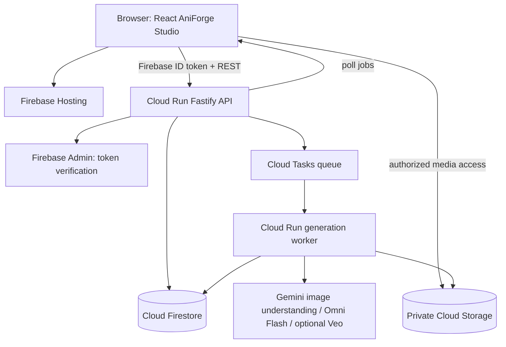

# AniForge AI — Hackathon Build Blueprint

**Edition:** AI Builder Cup 2026 | **Theme:** Media, Content & Digital Experiences  
**Working title:** AniForge AI — Draw it. Animate it. Edit it.  
**Target submission:** October 18, 2026 | **Stack:** React/Vite/TypeScript + Node/Fastify + Firebase + Cloud Run + Gemini

> This is a practical engineering blueprint, not a claim that every feature is supported automatically by an AI model. In particular, generated MP4s are **not** editable character/bone layers. AniForge stores editable source canvases, storyboard structures, overlays, scene timelines, prompts, and generation versions separately from rendered clips.

## 1. Project overview

AniForge AI is a web-based anime creation studio for artists, storytellers, students, indie creators, and beginners. A user can sketch an original character or scene, import an original manga panel, organize it into a storyboard, request Gemini's analysis, create a short animated clip through Google's video AI, edit/revise it with a prompt, arrange clips on a timeline, and export.

### Problem

Traditional 2D animation requires specialized skills, many frames, expensive software, and long production cycles. Current generative-video workflows can create moving visuals, but often lack an effective **creator-controlled, iterative workflow**: they are hard to align to an artist's storyboard, edit selectively, and version without starting over.

### Solution / differentiation

AniForge focuses on **artist control**: a source editor + storyboard + AI assistant + generative video engine + revision history + scene-level editing. It bridges the gap between static drawings and short animated sequences without pretending that text-to-video alone is a full animation suite.

### Hackathon positioning

- **Theme:** Media, Content & Digital Experiences.
- **Meaningful GenAI:** sketch/panel visual understanding, structured shot-plan extraction, image transformation, video generation, iterative video editing.
- **Novelty:** non-destructive generations linked to editable storyboard state; character reference cards; local changes rather than a monolithic one-shot movie.
- **Impact:** lowers the initial technical barrier to animated storytelling while keeping human creative direction in control.
- **Scalability:** independently processed per-scene jobs, storage-backed versions, web-first availability.

## 2. MVP: the demo-able vertical slice

### P0 (must work for submission)

1. **Authentication:** Firebase Auth Google sign-in or anonymous demo mode, with per-user project ownership.
2. **Project gallery:** create, rename, open, duplicate, delete one project; persisted in Firestore.
3. **Canvas:** create a 16:9 scene, pencil/brush/eraser, shapes, text, image layers; select, move, resize; undo/redo; save/reload actual editable scene JSON (not screenshots only).
4. **Import:** PNG/JPG/WEBP sketches, and uploaded manga pages; user manually crops/selects a panel (mandatory; automated segmentation optional). Permission statement on upload.
5. **AI analysis:** click Analyze Scene; pass image + user notes to Gemini; return validated, editable structured shot plan (subject, background, action, camera, mood, prompt, negative constraints); display the findings.
6. **Video generation:** send a saved scene image + validated plan through a backend adapter to **Gemini Omni Flash**; store video MP4, model name, prompt, output state, and prior interaction ID. Real Google model call (not a fake success).
7. **Iterative video edit:** user enters one change; backend supplies prior interaction ID when possible, saves a **new** version, and preserves the original.
8. **Timeline lite:** at least one real generated clip on a timeline; reorder and trim locally; add editable caption overlay; clip/version selection. A single clip can be downloaded as MP4. Multiclip encoded export is desirable but P1 if time is tight.
9. **Async UX:** queued/processing/completed/failed statuses with recoverable errors, no infinite spinner, no blocking page while video is being generated.
10. **Cloud deployment:** React frontend on Firebase Hosting; API/AI backend on Google Cloud Run; Firestore + Cloud Storage; fully deployed and available over HTTPS.

### P1 (only after P0 end-to-end is stable)

- Multiple scenes and assembled MP4 export using server-side FFmpeg.
- Character reference library with canonical character cards (appearance, palette, outfit, original image refs).
- Gemini image editing to refine sketches / clean backgrounds.
- First/last-frame constrained animation using Veo 3.1 where the provider and budget allow.
- Upload PDF manga or multiple sequential pages, with server-side PDF rasterization and manual crop.
- Audio/music tracks, caption SRT export, and per-shot transition choices.
- Job cancel UI (best-effort cancel, not a guarantee of reversing provider charges).

### Out of scope for submission

- Full anime episodes; real-time 3D rigs; skeletal animation; character-separated layers from flat video; professional keyframe animation of all subjects; accurate lip sync/dubbing; multiplayer editing; payment/subscription billing; training a foundation model.

## 3. User journey and demo story

**Demo asset:** entirely original sketch of an adult swordswoman holding a glowing blue blade in a rainy alley (make or commission rights-cleared sketch). Avoid references to copyrighted franchise characters.

1. Open AniForge → Sign in → Create Project “Neon Blade”.
2. Import the original black-and-white drawing; edit sword color using an overlay and save.
3. Click Analyze → Gemini identifies swordswoman, rainy alley, glowing sword and suggests motion / a medium-shot camera push.
4. User edits AI plan: “She draws her sword while neon reflections pulse in puddles. Preserve hairstyle and blue jacket.”
5. Click Animate → progress shows Queued / Generating; response becomes an MP4 clip in the editor.
6. Click Edit Video → “Increase the blue lightning effect, keep the character and the camera framing.”
7. A new version appears; compare prior and revised video, revert selection at any time.
8. Add a text caption, trim, save the scene, reload to prove persistence, and download MP4.

**Minimum acceptance:** The demo must call Gemini for meaningful interpretation, call Google AI for an actual clip, execute a real follow-up edit, persist versions, and run on Firebase/Cloud Run. No pre-rendered clips masquerading as live generation.

## 4. Recommended architecture

### Stack

| Layer | Choice | Reason |
|---|---|---|
| Web app | Vite + React + TypeScript | Fast, predictable SPA on Firebase Hosting |
| UI | Tailwind CSS + shadcn/ui or Radix + Lucide | Fast, accessible dark creative-editor UI |
| Canvas | react-konva / Konva | Canvas editing and object transforms; JSON-based scene elements |
| Client state | Zustand | Editor/timeline state; use reducer-based undo/redo |
| Data validation | Zod | Validate AI output, API requests, Firestore documents |
| Backend | Node.js TypeScript + Fastify | Shared types + Gemini JavaScript SDK |
| Auth | Firebase Authentication | Google sign-in or anonymous demo |
| Metadata | Cloud Firestore | Projects, scenes, assets, jobs, video versions |
| Asset store | Google Cloud Storage | Private sketches, previews, video files |
| Video model | Gemini Omni Flash via Gemini API | Prompt/image-to-video and iterative editing |
| Analysis | Supported Gemini multimodal model | Image understanding and structured shot plan |
| Image editing | Supported Gemini image-generation/editing model | Optional P1 refinement |
| Queues | Cloud Tasks → Cloud Run worker | Request-independent AI/video jobs and retries |
| MP4 composition | FFmpeg (later) | Stitch normalized clips, render captions / audio |
| Hosting | Firebase Hosting + Cloud Run | Explicitly eligible Google Cloud deployment |
| Tests | Vitest + Playwright | Unit, API, editor and e2e smoke |

Use `@google/genai` **server side only**. Keep the developer API key in Secret Manager / Cloud Run secret binding, never in Vite `VITE_*` vars.

### Component flow



### Important design details

- **Render source vs source-of-truth:** browser can rasterize an editable Konva scene into an image for model input, but store the original scene object JSON and asset references separately.
- **Provider adapter:** `VideoProvider.generate({sourceImage, prompt, references})` and `VideoProvider.edit({interactionId, prompt})` return normalized `VideoResult`; implement `GeminiOmniVideoProvider` first, `VeoVideoProvider` later. No provider-specific response fields in UI code.
- **Jobs:** `POST /jobs` creates a Firestore document and enqueues Cloud Tasks. UI polls `GET /jobs/:id` every 2-4 seconds or uses Firestore listener; workers update progress state. Queue retries must be idempotent, keyed by job ID.
- **Task handling:** tasks request an internal authenticated Cloud Run route. Avoid depending on an HTTP request staying open from the browser. For requests exceeding task deadline, use Cloud Run Jobs or a resumable operation workflow.
- **Video storage:** save finished MP4 in Cloud Storage and its metadata in Firestore. For large API responses prefer URI delivery when supported and download server side.
- **Versions:** each edit produces a new immutable video version. `previous_interaction_id` is retained for conversational edits; support re-upload fallback if prior provider interaction is no longer usable.
- **Canvas coordinate system:** canonical 1920×1080 scene coordinate space scaled to viewport. Save data in canonical coordinates so resizing UI does not move elements.

## 5. UX design and pages

**Visual direction:** dark creative suite, charcoal surfaces (`#0B0F19`, `#111827`), electric blue (`#4285F4`), purple accent, readable gray text, spacious panels. Do not use a general-purpose admin dashboard layout.

### Pages

1. `/` — landing page: demo, pricing disclaimer, primary “Open Studio” CTA.
2. `/projects` — project cards, create project, last edited, duplicate/delete.
3. `/studio/:projectId` — main editor, all project functions.
4. `/settings` — account and project preferences (optional).

### Desktop studio layout

```text
┌──────────────────────────────────────────────────────────────────────────────┐
│ AniForge   [Project title]     Undo Redo   Save   Generate   Export   Account │
├───────────────┬──────────────────────────────────┬───────────────────────────┤
│ Assets/Scenes │             CANVAS               │ INSPECTOR / AI ASSISTANT  │
│ + Import      │  editable drawing / storyboard  │ object layers & colors    │
│ Scene 1       │                                  │ Gemini scene analysis     │
│ Scene 2       │                                  │ motion / camera / prompt  │
│ Characters    │                                  │ Generate / AI Edit video  │
├───────────────┴──────────────────────────────────┴───────────────────────────┤
│  Timeline    [scene 1 / clip version / trim handles / captions]             │
│  [▶ preview] [00:00 ━━━●━━ 00:08]                [Generate new version]       │
└──────────────────────────────────────────────────────────────────────────────┘
```

### Accessibility / responsiveness

- Core desktop-first editor (large canvas); mobile users can browse, view, and play projects.
- Keyboard shortcuts: Ctrl/Cmd+Z, Shift+Ctrl/Cmd+Z, Delete, Space to play/pause; proper focus behavior.
- Labeled controls, keyboard-accessible modal, visible focus rings, sufficient contrast.
- For job states show text labels + progress skeleton; never rely on color alone.

## 6. Editable data and Firestore schema

**Collections** (all restricted to the current authenticated owner):

```text
users/{uid}
projects/{projectId}
projects/{projectId}/scenes/{sceneId}
projects/{projectId}/assets/{assetId}
projects/{projectId}/videoVersions/{videoVersionId}
projects/{projectId}/jobs/{jobId}
```

Suggested `projects/{projectId}`:

```json
{
  "ownerId": "firebase-uid",
  "title": "Neon Blade",
  "description": "Original anime action scene",
  "aspectRatio": "16:9",
  "sceneOrder": ["scene_01"],
  "createdAt": "serverTimestamp",
  "updatedAt": "serverTimestamp",
  "schemaVersion": 1
}
```

Suggested `scenes/{sceneId}`:

```json
{
  "projectId": "project_01",
  "title": "Blade Draw",
  "order": 0,
  "canvas": {"width":1920,"height":1080,"background":"#111827","objects":[]},
  "sourceAssetIds": ["asset_01"],
  "shotPlan": {"subject":"adult swordswoman","action":"draw sword","camera":"slow push-in","durationSeconds":6,"style":"original 2D anime","constraints":["preserve jacket"]},
  "selectedVideoVersionId": "version_02",
  "timeline": {"trimStart":0,"trimEnd":6,"captions":[]},
  "updatedAt": "serverTimestamp"
}
```

Suggested `videoVersions/{id}`: `sceneId`, `parentVersionId`, `generationKind` (`initial|edit`), `provider`, `model`, `prompt`, `sourceImageAssetId`, `referenceAssetIds`, `interactionId` (server-only or privileged metadata), `cloudStoragePath`, `durationSeconds`, `status`, `createdAt`, `costEstimateUsd` (optional). Do not expose provider credentials.

Suggested `jobs/{id}`: `ownerId`, `projectId`, `sceneId`, `kind`, `status` (`queued|running|succeeded|failed`), `attempts`, `idempotencyKey`, `errorCode`, `errorMessageSafe`, `resultVersionId`, `createdAt`, `updatedAt`.

Assets: `ownerId`, `projectId`, `sceneId`, `mimeType`, `sizeBytes`, `storagePath`, `width`, `height`, `copyrightAttested`.

**Storage paths:** `users/{uid}/projects/{projectId}/originals/...`, `renders/...`, `video/...`, `exports/...`.

## 7. API contract

All routes prefixed `/api/v1`. Public `GET /health` may omit authentication; all user work routes require a verified Firebase Auth ID token, backend ownership checks, and request validation.

| Method | Endpoint | Purpose |
|---|---|---|
| GET | `/health` | Health check |
| GET/POST | `/projects` | List/create owned projects |
| GET/PATCH/DELETE | `/projects/:projectId` | Read/update/delete project |
| POST | `/projects/:projectId/duplicate` | Duplicate editable project structure |
| GET/POST | `/projects/:projectId/scenes` | List/create scenes |
| GET/PATCH | `/projects/:projectId/scenes/:sceneId` | Save editable canvas, shot plan and timeline |
| POST | `/projects/:projectId/assets/upload-url` | Validate metadata, issue scoped signed upload URL or proxy |
| POST | `/projects/:projectId/assets/complete` | Verify uploaded object and register asset |
| GET | `/projects/:projectId/assets/:assetId/url` | Authorized temporary preview/download URL |
| POST | `/projects/:projectId/scenes/:sceneId/analyze` | Gemini image-to-structured-shot-plan |
| POST | `/projects/:projectId/scenes/:sceneId/generate` | Enqueue video generation and return job ID |
| POST | `/projects/:projectId/scenes/:sceneId/versions/:versionId/edit` | Enqueue conversational video edit |
| GET | `/projects/:projectId/scenes/:sceneId/versions` | Versions and metadata |
| PATCH | `/projects/:projectId/scenes/:sceneId/select-version` | Select previously generated version |
| GET | `/projects/:projectId/jobs/:jobId` | Read status/result of job |
| POST | `/projects/:projectId/export` | Download single clip; future multiclip export |
| POST | `/internal/jobs/execute` | Protected Cloud Tasks worker endpoint |

Return standardized `{data, error, requestId}` JSON; use meaningful 400/401/403/404/409/429/500/502 status codes. AI failure must never delete editable source or prior video versions.

## 8. AI workflow details

### 8.1 Gemini scene analysis

**Input:** rasterized source canvas or cropped panel + notes; optional canonical character card. **Output:** Zod-validated JSON:

```json
{
  "sceneSummary": "Original adult anime swordswoman in rainy alley",
  "subjects": [{"name":"swordswoman","appearance":"blue jacket; short black hair"}],
  "action": "Slow sword draw and slight turn toward camera",
  "camera": {"shotType":"medium","movement":"gentle push-in"},
  "environment": "Rainy neon street at night",
  "mood": "dramatic, cinematic",
  "animationPrompt": "6-second hand-drawn-style 2D anime sequence...",
  "preserve": ["blue jacket", "black hair", "sword shape"],
  "uncertainties": []
}
```

Gemini is asked to **describe observed details, not invent copyrighted identities**, and indicate ambiguity. User can modify all fields before video generation. Validate and sanitize JSON; never trust an AI response as a privileged instruction.

### 8.2 Video generation

- Provider: `gemini-omni-1.1-flash` through Google GenAI **Interactions API**, created from structured text + source image. Store `interaction.id` and video output.
- Default target: 4–8 second original 16:9 anime scene at 720p to control cost, while actual output options depend on model support.
- Example provider call (illustrative; check current SDK and account entitlement):

```ts
import { GoogleGenAI } from '@google/genai';
const ai = new GoogleGenAI({ apiKey: process.env.GEMINI_API_KEY! });
const interaction = await ai.interactions.create({
  model: 'gemini-omni-1.1-flash',
  input: [
    { type: 'image', data: base64Png, mime_type: 'image/png' },
    { type: 'text', text: animationPrompt }
  ]
});
if (!interaction.output_video?.data) throw new Error('No video returned');
const mp4 = Buffer.from(interaction.output_video.data, 'base64');
// Upload mp4 into private GCS and record interaction.id in a videoVersion.
```

For large outputs check the API's `delivery='uri'` option; don't assume inline base64 for every request or resolution.

### 8.3 Video edit / undo

For each edit, preserve the old version. The backend uses the source version's interaction ID as `previous_interaction_id`, when available:

```ts
const revised = await ai.interactions.create({
  model: 'gemini-omni-1.1-flash',
  previous_interaction_id: priorInteractionId,
  input: 'Make the sword glow bright electric blue; preserve outfit and shot composition.'
});
```

The newly created interaction ID becomes the new version's provider state. Never overwrite the old MP4. Important: the model tries to preserve untouched content but precise preservation is **not guaranteed**. If an interaction chain is unavailable, try an authorized video upload/edit path and clearly disclose it to the user.

### 8.4 Image editing (P1)

Use supported Gemini image-editing models to transform a sketch or modify an element. Save new raster as an `asset` and make it a selectable reference; do **not** claim to reconstruct editable source vectors or layers automatically.

### 8.5 Veo (P1 / optional)

Veo 3.1 supports first/last-frame-guided video and up to three visual references in supported configurations. Its API and cost are different from Gemini Omni Flash. Gate it behind a provider feature flag; test your actual API access first. Avoid hardcoding assumptions about model access or endpoint availability.

## 9. Generative prompts

### Scene analysis system prompt

> You are an original 2D anime storyboard assistant. Inspect the provided sketch or panel and return only JSON matching the supplied schema. Distinguish observable features from artistic guesses. Infer a feasible 4–8 second shot, preserving the input's subject identity and general composition. List ambiguous visual details under `uncertainties`. Do not invent existing franchise character names. Avoid adding written text not present in the source. Prefer clear, controllable camera instructions and one primary action.

### Animation prompt template

```text
Create an original {duration}-second 2D anime-style animation, 16:9.
SOURCE REFERENCE: Use the attached creator-owned illustration as your visual anchor.
CHARACTER: {subjectDescription}; preserve {preserveTraits}.
SCENE: {environment}.
ACTION: {singleAction}.
CAMERA: {shotType}, {cameraMovement}.
STYLE: clean drawn line work, consistent colors, readable silhouettes, controlled motion.
CONSTRAINTS: No new characters; no unrequested wardrobe changes; avoid flicker,
unwanted cuts and inconsistent props. No franchise logos or subtitles.
```

### Edit prompt template

```text
Edit ONLY the following aspects of the previous shot: {userRequestedChanges}.
Preserve subject identity, costume, shot composition and general sequence unless
explicitly changed. Keep motion continuity. Do not introduce unrequested props.
```

Never promise these constraints are perfectly guaranteed by the model; provide previews, versions, and retry options.

## 10. Scene editor implementation

### Canvas object model

Use typed data (`id`, `type`, `x`, `y`, `width`, `height`, `rotation`, `opacity`, `locked`, `hidden`, `zIndex`, `style`, optional `assetId`), not serializing framework internals. Typical object types: `image`, `brushStroke`, `rect`, `ellipse`, `line`, `text`. Separate canvas state from server schemas. Never store base64 images in Firestore documents.

### Essential interactions

- Mouse/touch draw, selection, translate, resize, optional rotate; pan/zoom.
- Layers panel with show/hide/lock and ordering.
- Properties inspector (position, scale, opacity, fill, stroke).
- Undo/redo with bounded in-memory snapshots; autosave via debounced PATCH.
- Import preview and manual crop with cancel/confirm.
- Save source scene as typed JSON; user can continue editing on reload.
- Video preview area toggles between editable canvas and generated clip.

### Timeline semantics

- `SceneTimelineTrack` contains clip versions with `trimStartSec`, `trimEndSec`, `sequenceIndex`, `overlays` and order.
- MVP: preview selected clip, adjust in/out points, compare video versions, caption elements. Editable timeline metadata != re-rendered encoded MP4 unless an export worker actually composites it.
- P1: run FFmpeg server-side to normalize frame rates/resolutions and assemble clips with text overlays.

## 11. Suggested monorepo layout

```text
aniforge-ai/
├── AGENTS.md
├── README.md
├── package.json
├── .gitignore
├── .env.example
├── firebase.json
├── firestore.rules
├── .github/workflows/ci.yml
├── docs/
│   ├── architecture.md
│   ├── api.md
│   └── demo-script.md
├── apps/
│   ├── web/
│   │   ├── src/
│   │   │   ├── app/                 # router, layout
│   │   │   ├── components/          # reusable controls
│   │   │   ├── features/editor/      # Konva, tools, layers
│   │   │   ├── features/projects/
│   │   │   ├── features/timeline/
│   │   │   ├── features/ai/
│   │   │   ├── lib/                 # API client, Firebase Auth
│   │   │   └── stores/
│   │   └── package.json
│   └── api/
│       ├── src/
│       │   ├── server.ts
│       │   ├── routes/
│       │   ├── services/           # Firestore, Cloud Storage
│       │   ├── ai/                 # Gemini analysis, providers
│       │   ├── jobs/               # queue + worker
│       │   ├── security/
│       │   └── types/
│       ├── Dockerfile
│       └── package.json
├── packages/
│   └── shared/
│       └── src/                 # Zod schemas, TS interfaces
└── tests/
    └── e2e/
```

## 12. Cost / resource strategy

- **Real API cost:** Google's official Gemini API pricing currently lists Gemini Omni Flash video output at approximately **US$0.10 per generated second of 720p video**, plus input and ancillary usage. An 8-second result is roughly **US$0.80 output-only**; generating it then doing three 8-second revisions would be approximately **US$3.20 output-only**. Confirm current pricing before testing.
- **Paid tier:** Omni Flash video creation is not on the free API tier. Configure billing and model access; test one tiny call first.
- Set a self-imposed max e.g. **$20–$40 AI experimentation budget** for hackathon testing, but do not rely on budget alerts as an automatic hard spending cap.
- Limit generated video duration/resolution, user generations/day, concurrent jobs. Require button confirmation for paid job submission, optionally display cost estimate.
- Enable Cloud Run max instances/concurrency limits and Cloud Tasks rate limit, but note these are not a substitute for provider-level quotas.
- Provide a **clearly labeled local demo/mock provider only in development** to build UX before spending; final submitted deployed demo must use real Google AI calls.

## 13. Security and content rights

- Firebase Auth JWT verified using Firebase Admin SDK in Cloud Run; server owner checks on every ID-based resource.
- Firestore and GCS private by default. Scoped signed URLs are short-lived; validate MIME/magic bytes, file size/dimensions, extension, path prefix and ownership.
- No Gemini keys in browser; store secrets in Secret Manager / Cloud Run bindings; never commit `.env`.
- Restrict CORS to web origins, implement input size caps, allowlist supported media, basic rate limits, job quotas, abuse logs, and per-project request IDs.
- Cloud Tasks internal endpoint must verify OIDC token of permitted queue service account; never trust an unverified task body.
- Uploaded manga/characters must be creator-owned or licensed; do not encourage unauthorized franchise transformations. Add disclosure that generated output can have imperfections, ownership rights depend on underlying source, and model safety rules apply.
- Render user-created text safely; do not evaluate canvas metadata as code.
- Do not publish source images or private media buckets publicly by default.

## 14. Development schedule (Oct 12–18, 2026)

### Oct 12 — Bootstrap + real API proof-of-concept
- Initialize repo and monorepo, Vite + Fastify, env config.
- Create Google Cloud/Firebase project and enable required APIs.
- Test **one** Gemini analysis call and **one** Omni short video call from server script. Confirm model availability, paid billing, outputs, and video download. This is the critical path.
- Codex output: running web shell, API `/health`, provider smoke test.

### Oct 13 — Project persistence + editor canvas
- Auth, Firestore project gallery, Cloud Storage upload flow.
- Konva canvas, drawing tools, undo/redo, object transforms, save/reopen JSON.
- Codex output: imported sketch survives refresh.

### Oct 14 — Gemini storyboarding + asset pipeline
- Manual panel crop, raster snapshot capture, Gemini structured shot plan with Zod, editable AI suggestion UI.
- Add protected uploads and downloaded preview URLs.
- Codex output: analysis of sketch produces real structured, editable text.

### Oct 15 — Generate video end-to-end
- Provider adapter, Firestore job records, Cloud Tasks workflow, Gemini Omni call, Cloud Storage result and clip player.
- Codex output: actual MP4 generated and displayed in deployed preview.

### Oct 16 — Iterative edit + versions
- Video editing prompt, interaction state, old/new MP4 versions, comparison UI, recoverable job errors, rate limit.
- Codex output: can compare initial vs edit, and switch back.

### Oct 17 — Finish, test, deploy
- Timeline lite, trim, download, accessibility, error handling, automated smoke tests, privacy checks.
- Deploy Firebase Hosting and Cloud Run. Run actual end-to-end flow from incognito browser with fresh project.
- Film or rehearse the 3-minute walkthrough; export slides to PDF.

### Oct 18 — Submit
- Final end-to-end test, review real quotas/billing, capture screenshots, 3-minute public video, short PDF deck, live URL, repo/doc link, clear theme selection. Submit before the published deadline, allowing for time zones and potential portal cutoff details.

**Fallback plan:** If video generation is denied/slow, prioritize fixing account/model/API access and keep an actual successful Google AI-generated clip recorded from the application (not a fake UX). If rate limits prevent repeated edits, the demo can show stored versions previously generated through the real service, **clearly describing that they were pre-generated**, while showing one live analysis or edit if allowed.

## 15. Acceptance tests and quality gate

- [ ] Visiting deployed link shows polished project studio.
- [ ] New user signs in and can create a project.
- [ ] Imported image keeps its dimensions, draws correctly, saves, reloads.
- [ ] Canvas objects move, resize, change opacity, undo and redo.
- [ ] Gemini real analysis of drawing returns schema-valid suggestion.
- [ ] Editing shot prompt doesn't erase original drawing.
- [ ] Generate request returns job ID immediately and progresses to success/failure.
- [ ] Real generated MP4 loads after refresh.
- [ ] Follow-up AI edit creates a new version without overwriting prior clip.
- [ ] Switch original/edited versions and compare both.
- [ ] Unauthorized user cannot read another user's project or media.
- [ ] Invalid uploads and model failures show actionable messages.
- [ ] Paid API secrets absent from browser bundle and git history.
- [ ] Cloud Run + Firebase Hosting publicly accessible.
- [ ] Project downloadable; no fake successes in demo.
- [ ] Demo video approximately 3 minutes and deck PDF prepared.

## 16. Hackathon pitch deck proposal (8 slides)

1. **Title:** AniForge AI: Draw it. Animate it. Edit it.
2. **Problem:** Idea-to-animation bottleneck and loss of control in one-shot generation.
3. **Target users + impact:** Indie creators, educators, original storytellers; earlier idea validation.
4. **Product journey:** sketch → analyze → animate → edit → export.
5. **Technical architecture:** Gemini models, Cloud Run, Firebase, Firestore, Cloud Storage, task queue.
6. **Differentiation:** non-destructive shot-level editing, source preservation, revision graph, user approval.
7. **Demo and evidence:** initial sketch, generated first clip, edited variant, retained original, deployed URL.
8. **Next steps + scaling:** consistent characters, animated keyframes, multiclip exports, cost/governance.

### 3-minute video script outline

- 0:00–0:20 — Problem and 1-sentence AniForge solution.
- 0:20–0:50 — Create project, import own sketch, edit on canvas.
- 0:50–1:20 — Gemini shot analysis and editable animation plan.
- 1:20–2:00 — Submit video generation and show result from real Google AI.
- 2:00–2:35 — AI instruction edits original clip, compare version history.
- 2:35–3:00 — Export, show deployed architecture / impact.

**Note on submission labels:** The themes page lists six industry themes but retains category wording from social-impact challenges in a separate part of the page. Choose Media, Content & Digital Experiences as primary and verify portal-specific labels with organizers.

## 17. Codex workflow / quality rules

1. Put `AGENTS.md` from this package in project root.
2. Keep `CODEX_MASTER_PROMPT.md` accessible to Codex; ask it to implement the next milestone only, not inventing test output.
3. Commit after each phase (`git commit -m "feat: ..."`).
4. Demand `npm run typecheck`, `npm run lint`, `npm run test`, `npm run build` (adjust scripts to actual implementation); if failing, Codex fixes before continuing.
5. Add unit tests for all model adapters by mocking API responses; never rely on production API for every unit test.
6. Integration test real AI models only when explicitly enabled and billed.
7. Have Codex document missing credentials / deployments, not pretend secrets or cloud resources already exist.
8. Keep README environment + deploy instructions and screenshot checklist current.

## 18. Configuration (illustrative — never commit credentials)

```dotenv
# apps/api/.env — local only
PORT=8080
NODE_ENV=development
GOOGLE_CLOUD_PROJECT=your-gcp-project-id
GCS_BUCKET=your-private-assets-bucket
GEMINI_API_KEY=replace-me
GEMINI_ANALYSIS_MODEL=select-supported-image-understanding-model
GEMINI_VIDEO_MODEL=gemini-omni-1.1-flash
CLOUD_TASKS_QUEUE=aniforge-generation
CLOUD_TASKS_LOCATION=us-central1
WORKER_URL=https://your-worker-url.run.app/internal/jobs/execute
TASKS_SERVICE_ACCOUNT=tasks-invoker@your-project.iam.gserviceaccount.com
ALLOWED_ORIGINS=http://localhost:5173,https://your-project.web.app
MAX_GENERATIONS_PER_USER_PER_DAY=5
MAX_VIDEO_SECONDS=8
ENABLE_REAL_AI=false
```

```dotenv
# apps/web/.env — public Firebase config values only
VITE_FIREBASE_API_KEY=your-firebase-web-config-value
VITE_FIREBASE_AUTH_DOMAIN=your-project.firebaseapp.com
VITE_FIREBASE_PROJECT_ID=your-project
VITE_FIREBASE_APP_ID=your-app-id
VITE_API_BASE_URL=http://localhost:8080/api/v1
```

Unlike `GEMINI_API_KEY`, a Firebase web app config key is an identification/config field rather than a server secret; authorization is enforced through Auth and security rules. Still avoid hardcoding privileged service-account credentials.

## 19. Deployment runbook (Windows PowerShell-friendly)

### Prerequisites

- Node.js current supported LTS and npm, Git, Google Cloud CLI, Firebase CLI, a Google Cloud billing-enabled project, and Gemini API access on the paid tier for Omni Flash.
- Firebase Auth, Cloud Firestore, Cloud Storage bucket, Cloud Tasks, Cloud Run, Secret Manager, Cloud Build, Artifact Registry enabled as needed.

### Useful setup commands

```powershell
npm install -g firebase-tools @openai/codex
# Google Cloud CLI: install from https://cloud.google.com/sdk/docs/install
firebase login
gcloud auth login
gcloud config set project YOUR_PROJECT_ID
gcloud services enable run.googleapis.com cloudbuild.googleapis.com artifactregistry.googleapis.com firestore.googleapis.com storage.googleapis.com cloudtasks.googleapis.com secretmanager.googleapis.com
```

Set up secrets in Secret Manager or from CLI with safe stdin practices (avoid exposing API keys in command history); grant only the Cloud Run runtime service account access. Configure service account Cloud Storage and Firestore IAM. Configure Cloud Tasks invoker identity and authorize `/internal/jobs/execute` separately from public API.

### Deploy API to Cloud Run

```powershell
# From the self-contained apps/api folder after Codex creates Dockerfile/build:
gcloud run deploy aniforge-api --source . --region us-central1 --allow-unauthenticated
```

Public invocation of API ingress is acceptable **only if** each user route authenticates and authorizes internally. Use authenticated Cloud Tasks requests for worker routes, ideally in a separately deployed private worker service. If using monorepo workspaces, build a multi-stage Dockerfile from **repo root**; do not deploy a workspace folder missing its shared package. Codex should choose and document one correct deploy path for the actual repo.

### Deploy static frontend

```powershell
# Build the workspace defined by Codex then from repo root:
npm run build --workspace apps/web
firebase init hosting
# Configure hosting public directory = apps/web/dist, and SPA fallback to index.html
firebase deploy --only hosting
```

Avoid synchronous requests waiting on generated video through Firebase rewrites: Hosting -> Cloud Run rewrites have a shorter timeout, so requests should enqueue and return job IDs, with polling for results. Cloud Run service regions and Firebase integration are described in linked docs.

## 20. References and documentation

### Competition

- Official AI Builder Cup: https://aibuildercup.com/
- Themes, submission and evaluation: https://aibuildercup.com/themes.html

### Google AI

- Gemini Omni Flash video generation/editing: https://ai.google.dev/gemini-api/docs/omni
- Omni model card: https://ai.google.dev/gemini-api/docs/models/gemini-omni-flash
- Gemini image generation/editing: https://ai.google.dev/gemini-api/docs/image-generation
- Veo 3.1 video generation: https://ai.google.dev/gemini-api/docs/veo
- Structured outputs: https://ai.google.dev/gemini-api/docs/structured-output
- Gemini API pricing: https://ai.google.dev/gemini-api/docs/pricing
- Google AI Studio: https://aistudio.google.com/

### Google Cloud / Firebase

- Firebase console: https://console.firebase.google.com/
- Cloud console: https://console.cloud.google.com/
- Firebase Hosting quickstart: https://firebase.google.com/docs/hosting/quickstart
- Firebase Hosting + Cloud Run: https://firebase.google.com/docs/hosting/cloud-run
- Firebase anonymous Auth: https://firebase.google.com/docs/auth/web/anonymous-auth
- Cloud Run deploy from source: https://docs.cloud.google.com/run/docs/deploying-source-code
- Cloud Tasks + Cloud Run async tasks: https://docs.cloud.google.com/run/docs/triggering/using-tasks
- GCS signed URLs: https://docs.cloud.google.com/storage/docs/samples/storage-generate-signed-url-v4
- Firestore quotas: https://firebase.google.com/docs/firestore/quotas
- Cloud budgets and alerts: https://cloud.google.com/billing/docs/how-to/manage-budgets

### Editor / coding

- React Konva: https://github.com/konvajs/react-konva
- Konva docs: https://konvajs.org/docs/
- React: https://react.dev/
- Vite: https://vite.dev/guide/
- Firebase JS SDK: https://firebase.google.com/docs/web/setup
- FFmpeg: https://ffmpeg.org/documentation.html
- Codex official repo: https://github.com/openai/codex
- Codex getting started: https://help.openai.com/en/articles/11096431
- Codex AGENTS.md guide: https://developers.openai.com/codex/guides/agents-md

## 21. Final engineering guidance

The **critical path** is proving real video model access on day one, then delivering one vertical slice that saves the underlying source and versions. Do not spend the whole week on beautiful UI while model access is untested. Do not claim full layer control over a generated MP4. Keep all inputs, prompts, versions and timelines editable, but communicate that video-level changes invoke the AI provider. The result can be a credible, polished hackathon prototype with a clear roadmap to a richer animation product.
