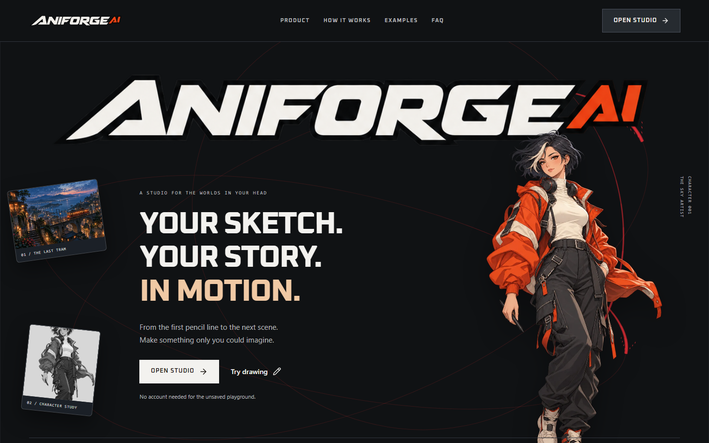
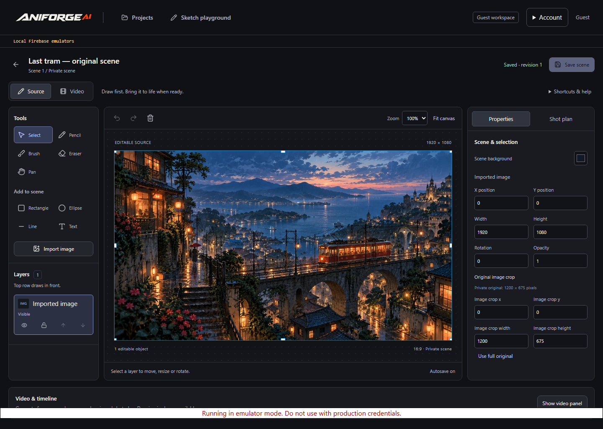
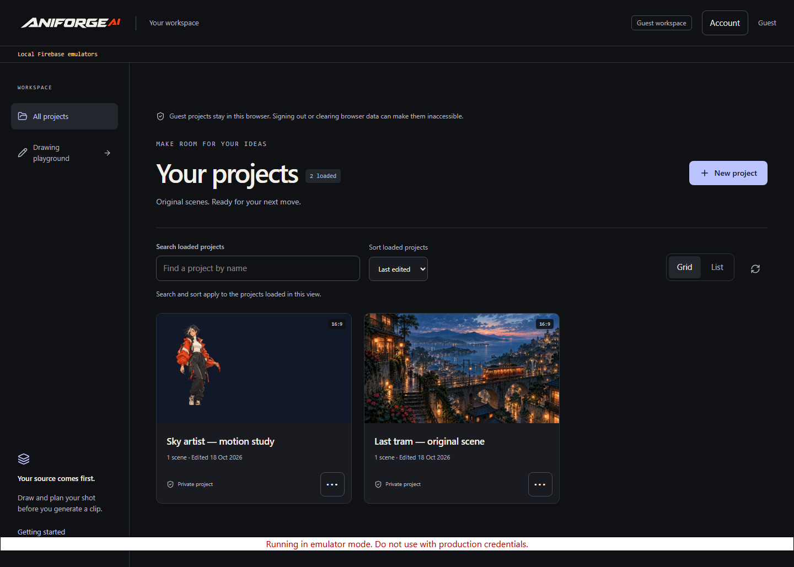
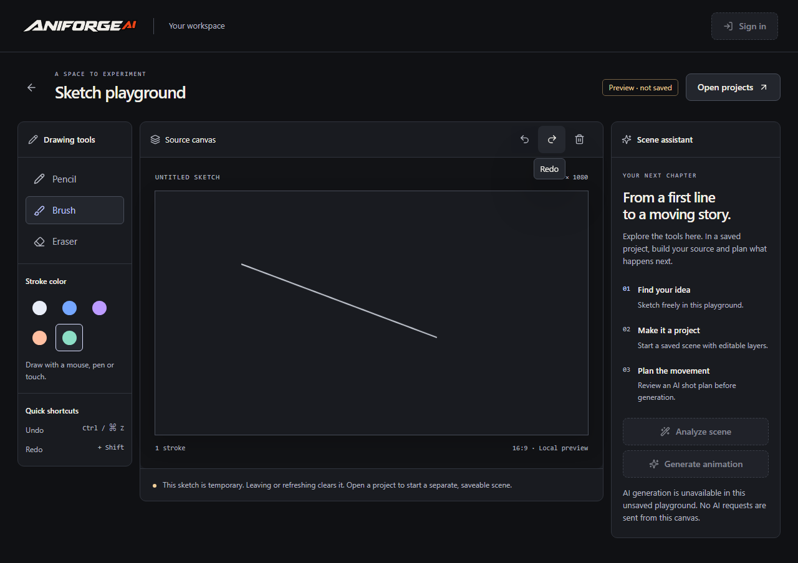
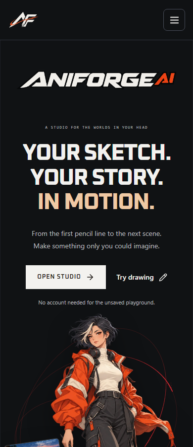
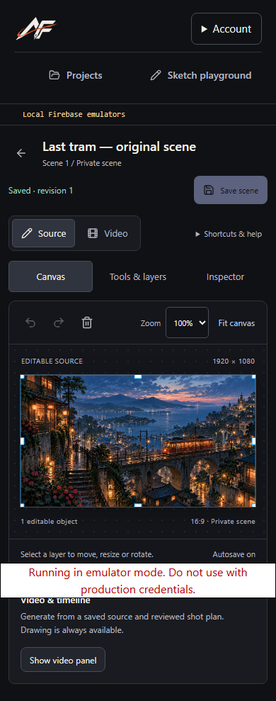
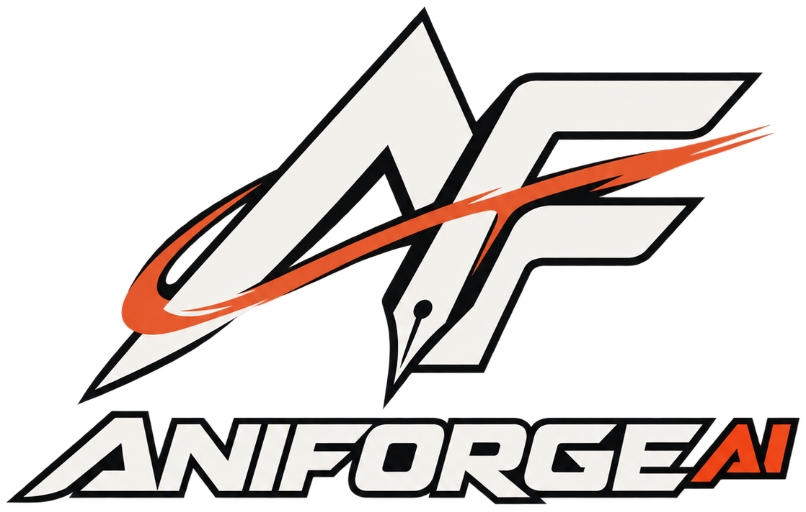

<div align="center">


<br />
**Your sketch. Your story. In motion.**

An anime creation studio for original artwork, editable scenes and versioned AI video.


[**Open AniForge ↗**](https://aniforge.shivafj.dev/) · [**Local setup**](#local-setup) · [**Build roadmap**](UI_UPGRADE_TODO.md) · [**Documentation**](#documentation)

<sub>Built for the AI Builder Cup 2026 · Original stories. Editable sources. Your creative direction.</sub>

</div>

---

## ✦ From first line to next scene

Draw an original character. Build a scene. Refine its direction. Keep your source editable while each generated clip gets its own version.

| ✎ Create | ◈ Direct | ▶ Animate | ⟳ Refine |
| :--- | :--- | :--- | :--- |
| Sketch, import, crop and arrange layers. | Write a shot plan or review a Gemini suggestion. | Request a clip through the server-side job workflow. | Compare revisions while preserving the original. |

> **Verified milestones · October 15, 2026**
>
> Firebase Hosting and Cloud Run are deployed, and the owner confirmed live Gemini analysis. A real server-side Gemini video request produced a **4.01-second, 720p MP4**; the deployed worker recovered that exact clip into private storage. Fresh signed-in browser generation and real follow-up editing remain separate acceptance checks. [Read the actual verification results →](docs/video-activation-results.md)

## 🎨 Inside the studio



<sub>Current homepage, captured locally on October 18, 2026. Character artwork is original promotional art, not an AniForge-generated video.</sub>

<details>
<summary><strong>✎ Source workspace — drawing, layers and saved scenes</strong></summary>



Fresh local Firebase-emulator capture, October 18, 2026. This shows the working editor; the scene is demo content, not Google-generated output. The emulator warning is intentionally visible.

</details>

<details>
<summary><strong>◈ Project library — your scenes, ready to reopen</strong></summary>



Local Firebase-emulator capture, October 18, 2026. Project data is isolated demo content.

</details>

<details>
<summary><strong>✦ Sketch playground — try the tools without an account</strong></summary>



Actual local drawing capture, October 18, 2026. This playground is unsaved and does not call AI services.

</details>

<details>
<summary><strong>↗ On your phone — the same studio, a smaller canvas</strong></summary>




Local captures at a 390px viewport, October 18, 2026. Saved-editor images use isolated Firebase emulators. [Capture provenance →](docs/readme/README.md) · [UI validation history →](docs/ui-upgrade-results.md)

</details>

### Your creative toolkit

- **Draw freely:** pencil, brush, eraser, shapes, text, image layers, transforms and undo/redo.
- **Keep your source:** editable scene JSON, autosave and revision-conflict recovery.
- **Direct the scene:** manual shot plans, prompt previews and review-before-apply analysis.
- **Preserve every take:** immutable video versions, parent links and comparison controls; a real follow-up edit remains to be verified.
- **Export honestly:** original MP4 plus timeline JSON. Preview trims and captions are not baked into the MP4.

`SOURCE JSON` → `SHOT PLAN` → `VIDEO JOB` → `IMMUTABLE MP4` → `NEW REVISION`

## 🏴‍☠️ A little Grand Line energy

For the One Piece fans: bring the big dreams, unlikely crews and sense of adventure. AniForge's own voyage starts with **your original world**.

**Original scene prompt · The Cloudwake Crew**

> An adult cartographer aboard a floating wooden skiff unfolds a glowing star map. Copper sails catch a gentle wind as cloud islands drift past. Slow camera push, warm sunrise, hand-drawn 2D atmosphere. Preserve the character and framing.

<sub>An original creative prompt, not a generated result. This project is unofficial and is not affiliated with One Piece. The logo and meteor banner belong to AniForge's own visual identity.</sub>

## Local setup

Node.js **24**, npm **11**, and Java **21+** for Firebase emulators.

```powershell
npm ci
npm run dev:emulators
```

Open **http://127.0.0.1:5173** → **Open studio** → **Continue as a guest** → create a project.

This mode uses isolated local Firebase services with AI disabled. Draw, save, reload and write manual shot plans without a paid model call. The separate sketch playground is explicitly unsaved.

<details>
<summary><strong>Local setup details & cloud configuration</strong></summary>

Install Node.js 24 LTS, npm 11 and Java 21+ (for emulators). From this repository root:

```powershell
npm ci
npm run dev:emulators
```

The frontend is at `http://127.0.0.1:5173`; choose **Open studio**, then **Continue as a guest**, create a project, and open the saved editor. Firebase Auth, Firestore and Storage run locally in the isolated `demo-aniforge` project. Gemini is disabled, and the launcher ignores personal environment files and cloud credentials. Use **Create manual shot plan** to edit and save direction without an AI call. The first run downloads official emulator binaries. See [local emulators](docs/local-emulators.md) for prerequisites, ports and data lifetime.

`npm run dev` starts the normal servers instead, using your configured environment. Without Firebase configuration, it provides only the explicitly unsaved playground and setup guidance. API health is `http://localhost:8080/health`.

To connect to cloud Firebase instead of local emulators:

```powershell
Copy-Item apps/web/.env.example apps/web/.env.local
Copy-Item apps/api/.env.example apps/api/.env
```

Fill in public Firebase web configuration on the frontend, and `GOOGLE_CLOUD_PROJECT` plus `GCS_BUCKET` on the API. Enable Google sign-in, create Firestore/private storage, and authenticate local application-default credentials as described in [cloud setup](docs/cloud-setup.md). The server loads `apps/api/.env` automatically. Restart development servers after configuration changes. Set `VITE_ENABLE_ANONYMOUS_AUTH=true` only if anonymous Auth is enabled in the Firebase console.

Server secrets belong in ignored API environment files or Secret Manager. Never put a Gemini key or service-account credential in `VITE_*`, browser code or Git. There is no need to send secrets in chat.

</details>

## 🔧 Under the hood

<details>
<summary><strong>Full feature inventory</strong></summary>

- Standalone public homepage with original artwork, interactive local examples, FAQ and direct links to saved projects or the unsaved drawing playground. It loads without Firebase or the editor.
- Dedicated project dashboard with grid/list views, search/sort of loaded projects, private saved-source thumbnails, project action menus and dismissible onboarding. Creation opens the saved editor immediately. Firebase Google sign-in, optional anonymous sign-in and owner-only project CRUD/duplication use Firestore when configured.
- Saved canonical scene JSON with autosave/manual save, revision conflicts, pencil/brush/eraser, shapes/text, selection/transforms, layers, inspector and undo/redo. Cloud projects use the saved editor; the separate no-sign-in playground remains explicitly **unsaved** and now uses the shared visual system with responsive tools, canvas and assistant panels. [Playground captures](docs/ui-playground/README.md).
- Private PNG/JPEG/WEBP imports through the authenticated API, original-content affirmation and manual panel cropping. Images are validated and normalized to PNG; media bytes stay outside Firestore. Project copies receive independent images.
- Editable shot plans and prompt preview saved with the canvas. Configured real Gemini analysis receives a private canonical snapshot and returns a separate suggestion for explicit review/apply. Revision checks, durable request IDs, attempt limits and safe error states protect existing work. Manual plans work without AI credentials.
- Real server-only Gemini scene analysis, Omni image-to-video and conversational-edit smoke commands. They require explicit paid opt-in, a server key and original-content affirmation. No fake/live fallback exists.
- Queue-backed video jobs, per-user attempt limits, trusted OIDC worker, immutable private MP4 versions, status polling and a player. Durable checkpoints retry existing media downloads without regenerating. See [worker setup](docs/video-worker-setup.md).
- Conversational edits create new immutable clips with parent links and prompt history. Compare parent/revised playback, save or restore the selected version, and preserve existing media when an edit fails. Expired interaction history offers an explicit stored-video upload mode with separate paid consent; there is no automatic paid fallback.
- Saved trim/caption metadata affects the browser preview. Download the selected version's original MP4 and separate timeline JSON; trim and captions are **not rendered into the MP4**.
- Cloud deployment configuration, private database/storage rules, CI and scoped credential documentation.
- Release-only Firebase/API configuration validation, Hosting predeploy build, bounded browser-secret scan, compiled API smoke and CI container checks. Local preparation does not mean deployment has succeeded.

</details>

<details>
<summary><strong>Real model smoke tests — paid setup required</strong></summary>

Set server `GEMINI_API_KEY` and `ENABLE_REAL_AI=true` only after confirming billing and entitlement. Defaults are `gemini-3.8-flash` for analysis and `gemini-omni-1.1-flash` for video. Model interface verification and exact follow-up edit commands are in [the smoke-test guide](docs/model-verification.md).

```powershell
npm run build
npm run smoke:analysis -- --image 'C:\Art\original.png' --attest-original
npm run smoke:video -- --image 'C:\Art\original.png' --attest-original --prompt 'Create a 6-second original 2D anime shot. Preserve the subject and framing; animate a gentle breeze.'
```

Use absolute image paths. Each successful run saves its validated output and metadata into a new ignored `apps/api/artifacts/ai-smoke/` directory. Edits create separate files and retain the parent interaction ID. Manually play any resulting MP4: container validation alone does not prove correct playback or requested motion. All failed/disabled commands exit nonzero and do not claim success.

</details>

<details>
<summary><strong>Quality checks & test boundaries</strong></summary>

```powershell
npm run typecheck
npm run lint
npm run test
npm run build
npm run test:built-api
npx playwright install chromium
npm run test:e2e
npm run test:emulators
npm audit --omit=dev
```

Unit tests use explicitly isolated auth/repository/provider doubles. The unconfigured browser smoke tests cover rendering, drawing, undo/redo and mobile fit. The separate emulator suite exercises real local Auth, Firestore, Storage and browser save/reload; it does not prove production IAM or cloud deployment. See [Phase 2 results](docs/phase-2-results.md) and [Phase 1 results](docs/phase-1-results.md) for executed commands, counts and limitations.

Browser tests inject explicitly labeled providers into test-only API instances while using real local Firebase services. They check source PNG pixels, analysis review/save/reload, video queuing, independent parent/revised playback, saved selection/timeline, exact MP4 downloads and safe failures. These fixtures are not live Gemini evidence. See [Phase 5 results](docs/phase-5-results.md) for implementation checks and [video activation results](docs/video-activation-results.md) for the later real-provider/cloud evidence and remaining acceptance checks.

The pinned Firebase CLI is a development dependency and currently brings transitive npm advisories; the production dependency audit is separate. Do not run `npm audit fix --force` to downgrade the CLI or silently break its dependencies. The local emulators bind only to loopback.

</details>

## Documentation

```text
aniforge-ai/
├── apps/web/          React · Vite · Konva · Firebase Auth
├── apps/api/          Fastify · Google AI · private worker
├── packages/shared/   Zod schemas · shared TypeScript
├── tests/             Unit, browser and emulator checks
└── docs/              Setup, architecture and evidence
```

| Find your heading | Read next |
| :--- | :--- |
| Architecture & scope | [Build plan](BUILD_PLAN.md) · [Architecture](docs/architecture.md) · [API](docs/api.md) |
| UI & editor | [UI roadmap](UI_UPGRADE_TODO.md) · [Source workspace](docs/editor-workspace.md) · [Video workspace](docs/video-workspace.md) |
| Cloud & credentials | [Cloud setup](docs/cloud-setup.md) · [Private worker](docs/video-worker-setup.md) · [Models](docs/model-verification.md) |
| Release & demo | [Submission draft](SUBMISSION_DRAFT.md) · [Demo script](docs/demo-script.md) · [Release checklist](docs/release-checklist.md) · [Acceptance gates](TODO.md) |
| Actual results | [UI validation](docs/ui-upgrade-results.md) · [Video activation](docs/video-activation-results.md) · [README captures](docs/readme/README.md) |

## ⚓ Build with us

Read [AGENTS.md](AGENTS.md) and the [build plan](BUILD_PLAN.md) before contributing. Keep changes small, TypeScript strict and failure states visible. Record actual checks and distinguish test fixtures from live model evidence.

Server secrets stay in ignored API environment files or Secret Manager. Generated clips are flat MP4s; editable sources, captions, shot plans and version history remain separate data.

---

<div align="center">



**Draw it. Animate it. Make it yours.**

<sub>Built for creators with a world in their head and a sketch to start it.</sub>

[Open the studio](https://aniforge.shivafj.dev/) · [Read the roadmap](TODO.md)

</div>
