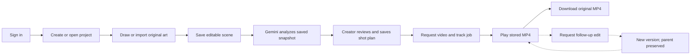
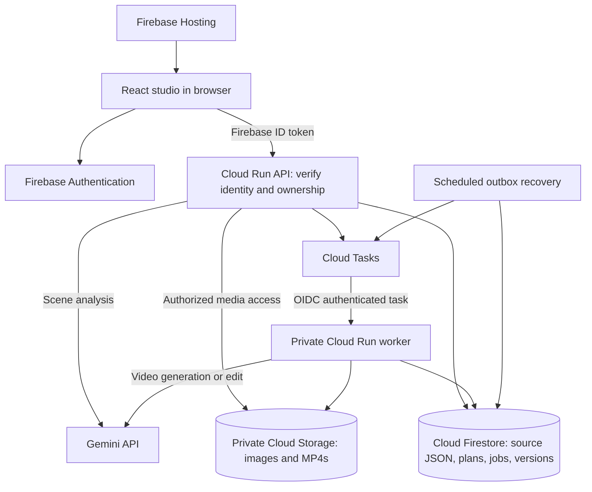

# AniForge AI — AI Builder Cup submission draft

Prepared October 18, 2026. This is filled submission copy and a slide-by-slide content guide, **not the final pitch deck**. Paste the slide content into the organizer's prescribed template and retain its headings, branding and layout. Follow the portal's required final file format; do not submit this Markdown file as the pitch deck.

Source template: `Submission Template _ AI Builder Cup (1).pdf`, supplied by the project owner (16 pages). `[ADD: ...]` and `[CONFIRM: ...]` mark information that cannot be supplied reliably from the project records. Preparation notes and evidence links are for the presenter, unless explicitly included as slide copy.

## Submission form — ready-to-copy fields

**Project / solution name:** AniForge AI

**Tagline:** Your original art. A directed shot. Motion you can build on.

**Theme:** Media, Content & Digital Experiences. [CONFIRM: exact category label in the submission portal.]

**Team name:** AniForge AI [CONFIRM: replace with the registered team name if different.]

**Team leader:** [ADD: full name exactly as registered.]

**Brief description:**

> AniForge AI is a browser-based anime creation studio that helps creators develop short animated shots from their own original artwork. Creators can draw or import a sketch, edit its objects and layers, save the scene, and ask Gemini to propose a structured shot plan covering action, camera movement and visual constraints. They review the plan before requesting video generation.
>
> Firebase Hosting serves the frontend, and Firebase Authentication provides Google sign-in. Cloud Firestore stores projects, editable scene JSON, shot plans, job state and video-version metadata. Cloud Run hosts the authenticated API and a private background worker; Cloud Tasks dispatches generation jobs. Gemini runs on the server for scene analysis and video generation, with API credentials kept out of the browser. Original artwork and generated MP4s are stored in private Cloud Storage.
>
> Real Gemini analysis and an initial video generation have been verified, including private cloud storage of the generated clip. The application also implements preserved video versions and follow-up edit controls; live follow-up editing remains to be verified. Editable drawing data stays separate from the generated MP4.

**Deployed prototype:** [https://aniforge.shivafj.dev/](https://aniforge.shivafj.dev/)

**GitHub repository:** [https://github.com/SMani0547/AniForge-AI](https://github.com/SMani0547/AniForge-AI)

**Demo video:** [ADD: accessible link to the final 3–4 minute recording.]

**Access check, October 18:** the homepage and API health endpoint returned HTTP 200. The repository URL returned **HTTP 404 without authentication**; confirm the URL and make the intended submission repository public before submitting. These HTTP checks do not establish that sign-in, saved projects or paid generation work end to end today.

## Prescribed pitch deck — page-by-page content

Page numbers below refer to the supplied PDF, including its instruction page. Do not replace this with the old eight-slide outline.

### Page 1 — Team Details

- **a. Team name:** AniForge AI [CONFIRM: registered team name.]
- **b. Team leader name:** [ADD: registered team leader's full name.]
- **c. Problem Statement:** Independent anime creators need a practical way to turn an original drawing into a directed animated shot while retaining their editable source, creative intent and earlier video versions. AniForge brings drawing, shot planning and AI video generation into one saved project.

Preparation note: the problem statement above describes the project; if the portal assigns an official problem-statement title or ID, add that exact selection. No official ID is available in the project records.

### Page 2 — Template download instructions

This is the organizer's instruction page, not a content field. It instructs participants to download the template as Microsoft PowerPoint rather than request edit access. Use that original editable template for the final deck. Retain or remove this instruction page only as directed by the organizer; do not redesign the supplied deck around it.

### Page 3 — Brief about the idea

**From an original sketch to a directed animated moment.**

AniForge AI connects an editable drawing workspace, Gemini-assisted shot planning and short-video generation. The creator reviews the direction before generation, keeps the source drawing, and can revisit saved projects and video versions.

Designed for independent illustrators, aspiring anime creators and visual storytellers exploring a short scene.

**Prototype evidence:** live analysis confirmed; one real Gemini video verified; private cloud recovery and storage verified. Fresh browser generation and live follow-up editing remain acceptance checks.

### Page 4 — Opportunities

**How different is it from any of the other existing ideas?**

AniForge combines editable source artwork, a reviewed shot plan and traceable video versions in one workflow. Its design gives the creator explicit control over direction and preserves the relationship between the drawing and generated outputs.

**How will it be able to solve the problem?**

Creators can refine the source, ask Gemini for a structured plan, adjust the suggested motion, and request a clip without rebuilding the project at each step. Saved scenes and version history support revisiting creative decisions.

**USP of the proposed solution**

**An anime-focused creation workspace that preserves the source, the direction and the result.**

Preparation note: these are product design choices and intended benefits. No competitor benchmark, customer study or measured time saving has been completed; do not claim market exclusivity.

### Page 5 — List of features offered by the solution

- Google sign-in and private project library.
- Drawing tools, image import/crop, layers, transforms and saved editable scenes.
- Gemini scene analysis with a structured, reviewable shot plan.
- Queued video generation with visible progress and failure states.
- Stored MP4 playback and original-file download.
- Immutable video-version records and follow-up edit controls.*
- Saved trim/caption preview settings with a separate timeline JSON download.

**Scope:** MP4s are flat videos; drawing objects remain editable separately. Trim and captions affect browser preview and are not encoded into the MP4 download.

*Follow-up editing is implemented and covered by test fixtures; a real Google edit has not yet been verified. Fresh signed-in production generation/playback/download also remains to be observed; the verified initial video came from a server-side smoke test.*

### Page 6 — Process flow diagram or Use-case diagram

Diagram caption: Solid arrows show the intended initial workflow; components have differing verification status. Dashed arrows identify the implemented edit path awaiting real-model verification. Source edits are saved separately from video output.

Preparation note: render the diagram as a legible image or recreate it with PowerPoint shapes inside the template; do not paste raw Mermaid code into the slide.

### Page 7 — Wireframes/Mock diagrams of the proposed solution (optional)

**Project library → source workspace → video workspace**

| View | Main elements |
| --- | --- |
| Project library | Project cards, search and create/open actions |
| Source workspace | Drawing tools, central canvas, layers/properties, shot plan and save status |
| Video workspace | Player, version selection, job status, edit instruction, timeline preview and downloads |

Suggested visual: use the existing [source workspace capture](docs/ui-saved-shell/workspace-source-1440.png) as an implementation illustration. Use the [video workspace capture](docs/ui-u5/video-review-1440.png) only with its **TEST FIXTURE — NOT AI OUTPUT** label and an explicit local-test caption. Replace with current production captures where available.

### Page 8 — Architecture diagram of the proposed solution

**Boundaries:** Firebase Authentication establishes identity; the API checks project ownership. Firestore stores editable data and state; Cloud Storage holds private media. Gemini calls and credentials stay on the server. Cloud Tasks separates long video work from browser requests.

Preparation note: the recovery component is a Cloud Run job invoked by Cloud Scheduler. Show Secret Manager as a small server-side annotation if space permits. The separate media-deletion schedule is deferred; it is not this recovery job. This is the implemented architecture, not proof that every user path has passed live acceptance.

### Page 9 — Technologies to be used in the solution

| Layer | Technology and role |
| --- | --- |
| Studio | React, Vite, TypeScript, Tailwind CSS, react-konva |
| Hosting and identity | Firebase Hosting; Firebase Authentication with Google sign-in |
| Application database | Cloud Firestore: projects, scene JSON, plans, jobs and versions |
| Backend | Node.js, TypeScript, Fastify on Cloud Run; Zod validation |
| AI | Server-side `@google/genai`; Gemini for analysis and video |
| Media and execution | Private Cloud Storage; Cloud Tasks; Cloud Scheduler recovery |
| Secrets and delivery | Secret Manager; Docker, Cloud Build and Artifact Registry |
| Verification | Vitest, Playwright, Firebase emulators and real-provider smoke checks |

Recorded model configuration: `gemini-3.8-flash` for analysis and `gemini-omni-1.1-flash` for video. These names reflect the project's October 15 verification record, not a claim about future availability. AniForge integrates existing models; it does not train a foundation model.

### Page 10 — Estimated implementation cost (optional)

**Prototype cost structure:** model usage plus cloud execution, storage and delivery.

- AI usage: scene analysis, initial video generation and each requested video edit.
- Infrastructure: Cloud Run API/worker compute, Firestore operations, private media storage and downloads, Tasks, Scheduler and build artifacts.
- Controls: explicit paid-generation confirmation, daily attempt limits and duplicate-request protection. These do not constitute a guaranteed project-wide spending cap.

**Measured cost per clip: not yet established.** Actual charges were not read during the verified smoke test. Trial or partner credits are funding, not evidence of sustainable unit cost.

If a numeric estimate is desired: [ADD: dated billing measurements, expected monthly active creators, analysis/generation/edit counts, retention and download assumptions, and currency.] Use those inputs to estimate monthly model charges + compute + database + media storage/delivery. Do not present a guessed dollar figure as a measured result.

### Page 11 — Snapshots of the prototype

Build a four-panel screenshot slide with these captions. Use production captures for the final working-demo story wherever possible.

| Panel | Caption | Available material / remaining action |
| --- | --- | --- |
| 1 | AniForge AI — original-art creation studio | [Existing homepage capture](docs/ui-motion-rhythm/hero-meteor-flames.png); a local October 14 UI capture, not a current uptime check |
| 2 | Editable source and saved scene | [Existing source workspace capture](docs/ui-saved-shell/workspace-source-1440.png); local/emulator UI evidence. [ADD: current saved project capture after refresh.] |
| 3 | Gemini analysis → reviewed shot plan | [ADD: screenshot of the actual Gemini suggestion in the signed-in production project. Live analysis was confirmed by the owner, but no suitable submission screenshot is selected here.] |
| 4 | Real Gemini output — 4.01-second, 720p clip | Available privately: `artifacts/ai-smoke/video-ae1e2a91-58bb-477b-baea-70cb3d65ce00/playback-frame.png`. This is server-side smoke output, not a screenshot of a fresh browser generation. [ADD: a production player capture after the live browser check.] |

Preparation note: the real smoke MP4 is in the same ignored artifact folder as its playback frame. Use only the frame/clip for the deck or recording; keep raw provider metadata private. Do not use geometric fixture videos as Google output. Captures in `docs/ui-u5/` and `docs/demo/` are explicitly test fixtures.

Brand asset: [AniForge wordmark](apps/web/public/brand/wordmark.png). Preserve its aspect ratio and the organizer's template branding.

### Page 12 — Prototype Performance report/Benchmarking

| Check | Observed result | Date and scope |
| --- | --- | --- |
| Real Gemini initial video | 40,886 ms generation + download; 1,906,656-byte MP4 | Oct 15; one server-side sample, not a latency average |
| Browser playback of that MP4 | 4.01 s, 1280 × 720, 96 decoded frames; played to end | Oct 15; local Chromium |
| Deployed recovery and privacy | Same MP4 bytes stored; one immutable version; anonymous media access returned 403 | Oct 15; actual cloud worker recovered the existing provider result |
| Completed-job redelivery | One version retained; no new model generation | Oct 15; one observed redelivery |
| Quality checks | Typecheck, lint, 208 unit tests and release build passed | Oct 15; historical results, not rerun for this draft |
| Browser/emulator checks | 40 tests passed | Oct 15 preceding fix; isolated emulators and labeled AI fixtures |
| Submission URL reachability | Homepage + API health: 200; GitHub: 404 without authentication | Oct 18; HTTP reachability only |

**Limitations:** no load/concurrency benchmark, average latency, measured per-clip cost or user study. Initial video verification does not prove exact adherence to every visual instruction. Fresh browser generation and live follow-up editing remain outstanding.

Preparation note: fit the five most useful rows on the slide if necessary, keeping the scope qualifiers. The [video activation report](docs/video-activation-results.md) contains the detailed evidence; it also records a passed 32-file browser-artifact scan, which is a bounded check, not a security certification.

### Page 13 — Additional Details/Future Development (if any)

**Before final acceptance**

- Complete a fresh signed-in production video request, reload/playback and download.
- Verify one real follow-up edit, including parent/child playback and preservation of the original.
- Resolve public repository access and rehearse the final demonstration.

**Next product steps**

- Encode trim/captions into exported video and support multi-scene assembly.
- Add an original-character reference library for more consistent direction.
- Measure quality, latency, cost and reliability across representative creator scenes.

**Responsible operation:** original/authorized artwork, explicit paid actions, server-side secrets, private media and visible job errors. Keep deployment, account access and sufficient model allowance available throughout evaluation.

### Page 14 — Provide links to your:

- **GitHub Public Repository:** [AniForge-AI](https://github.com/SMani0547/AniForge-AI) — [ACTION: resolve unauthenticated 404 and verify public access.]
- **Demo Video Link:** [ADD: final accessible recording URL.]
- **Final Product Link:** [AniForge AI](https://aniforge.shivafj.dev/)

Preparation note: the PDF labels the demo as “3 Minutes”; the later mandatory rules supplied by the owner specify **3–4 minutes**. The [demo script](docs/demo-script.md) targets **3:30** and includes a 3:00 edit option if the portal enforces that exact template label. Verify the uploaded duration and current portal instructions before submitting.

### Page 15 — Blank branded page

No content prompt appears on this page. Do not invent an additional required section. Leave its treatment consistent with the official template instructions; use it as an appendix only if the organizer permits.

### Page 16 — Thank you

Retain the supplied closing slide. If its editable layout permits a link, use `aniforge.shivafj.dev` without covering the organizer's branding.

## Final preparation checklist — not slide copy

- [ ] Confirm registered team name, team leader and any official problem-statement ID/category.
- [ ] Copy slide content into the prescribed editable template; preserve the required format and export as the portal requests.
- [ ] Replace screenshot placeholders with readable captures, retaining truthful evidence captions.
- [ ] Resolve the GitHub 404; verify the final public repository link in a signed-out/incognito window. This draft did not change repository visibility.
- [ ] Commit/push intended source and supporting materials; exclude secrets and private provider metadata.
- [ ] Verify a fresh production sign-in, project open/create, source save/reload, Gemini analysis and video generation/playback/download. Record actual results.
- [ ] Verify a real follow-up edit before presenting it as working. Otherwise retain the limitation in the deck and narration.
- [ ] Record the [3:30 demo script](docs/demo-script.md), upload it, and insert its accessible link in both the portal and deck.
- [ ] Check the uploaded video's duration and playback without your account; do the same for the deck/repository links.
- [ ] Keep the deployed app, APIs, model billing/access and required cloud services working throughout evaluation. Ensure a judge can sign in with their own permitted Google account; document any unavoidable access restriction before submission.
- [ ] Submit the deck, video link, deployed link, public repository link and brief description. Save a copy of the final submission.

## Evidence used to prepare this draft

- Supplied 16-page PDF and the mandatory submission rules pasted by the owner.
- [Build plan](BUILD_PLAN.md) and [architecture](docs/architecture.md): intended scope and implementation boundaries. Some older status paragraphs are historical.
- [Cloud setup progress](docs/cloud-setup-progress.md) and [video activation results](docs/video-activation-results.md): October 15 analysis/video evidence and unverified acceptance steps. Prefer these dated results over older “pending deployment” text.
- [Video UI capture provenance](docs/ui-u5/README.md) and [source UI capture provenance](docs/ui-u4/README.md): local/emulator evidence, not real-model claims.
- October 18 read-only HTTP checks: homepage 200, API health 200, unauthenticated repository 404. No signed-in production workflow, paid AI call or new application test run was performed to prepare this document.
