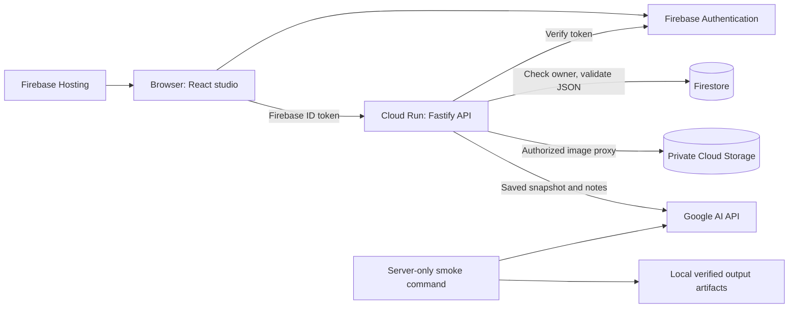
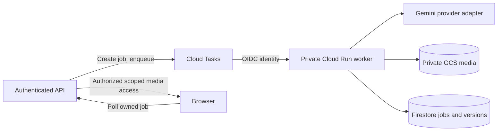

# Architecture

AniForge stores editable scene data separately from rendered video. A generated MP4 remains a flat clip. The P0 sequence is foundation/auth/projects, canvas and private assets, Gemini analysis, queued video, immutable conversational revisions, and deployment verification. `BUILD_PLAN.md` remains the product blueprint; `TODO.md` records implementation and test evidence.

## Implemented boundaries

| Workspace | Responsibility |
| --- | --- |
| `apps/web` | React/Vite/TypeScript studio, Firebase Auth, paginated gallery, editable canvas/layers/crop and shot plan, revision-aware autosave, canonical snapshot rendering and analysis review |
| `apps/api` | Fastify, Firebase Admin ownership checks, Firestore revisions, private media, real Gemini analysis with durable request/usage records, server-only video smoke commands |
| `packages/shared` | Strict TypeScript/Zod API and editable scene contracts shared by browser and server |

The frontend never imports Firebase Admin or `@google/genai`. Public Firebase web configuration belongs in the Vite environment. Gemini credentials remain on the server. Local development may display an explicit setup state when credentials are absent; it must not manufacture successful sign-in, database writes, or AI output. Test fixtures are injected by tests and are not an alternative production provider.

Phase 3 adds an authenticated synchronous analysis route with a 40-second default provider deadline. A browser export of the saved canvas is uploaded as private PNG; a transaction checks its ownership, scene revision and metadata before reserving an analysis ID and user allowance. The provider receives image bytes and notes only from the server. Structured results pass Zod validation before a server-only analysis record is marked complete. Replaying the same ID cannot automatically create another paid call. Suggestions never overwrite the source or saved plan; explicit application uses the ordinary revision-checked scene save.

Production API startup requires a Cloud project ID. Local health can boot without it, while project operations report that configuration is unavailable. Health proves the process is responding; it is not an assertion of database connectivity or model entitlement. The smoke commands are separate from public HTTP routes and explicitly opt into real billable calls.

## Data and trust boundaries

Project documents live at `projects/{projectId}` and contain `ownerId`; scenes are children at `projects/{projectId}/scenes/{sceneId}`. Every user route authenticates before accessing a project and checks ownership before reading or mutating its scenes. Cross-owner access is concealed with 404. Client-provided ownership and timestamps never authorize an operation. Zod schemas define accepted input and output.

Analysis records live at `projects/{projectId}/analyses/{analysisId}` and contain input fingerprints, source revision, private snapshot reference, state, safe error/result and a server-only provider interaction ID. `analysisUsage/{hashedUid}` stores the owner, UTC-day attempt count and bounded active reservation across API instances. These are accessed only through Firebase Admin. Usage survives project deletion so deleting a project cannot reset the allowance. Completed/failed request IDs are not automatically re-dispatched; a crash may leave a pending ID requiring provider inspection.

All Firestore browser access is denied by `firestore.rules`. Admin SDK calls bypass rules, so IAM protects the database identity and the API enforces per-user isolation. This backend-only approach keeps the ownership policy in one application boundary. [Firestore security model](https://firebase.google.com/docs/firestore/security/overview).

Scene source uses canonical 1920×1080 coordinates, object IDs, transforms, styles, layer ordering and source asset references. The saved editor loads this JSON and uses it as its source of truth; no Konva framework internals or base64 images are stored. Revisions provide optimistic concurrency: the server atomically rejects stale saves and increments the revision on success. The client serializes saves and retains edits made while a request is in flight; a conflict requires an explicit reload before subsequent saves.

Images enter through an owner-authenticated binary upload proxy. Signature checks, bounded decoding, EXIF orientation and PNG normalization occur server-side. An asset has its own immutable media path and an attestation; scenes retain a reference and editable crop rectangle. Browsers fetch image bytes with Firebase ID tokens and display temporary Blob URLs. There are no permanent public media URLs or bucket keys in the client.

Asset reservations precede media writes. Duplication copies referenced images to new IDs and project paths while the destination is hidden; a final transaction checks source revisions and publishes the copied scenes and metadata together. Deletion marks a project unavailable before purging descendants and media. Durable operation records allow cleanup retry after a failed request or restart; they must not be mistaken for user-visible projects. Recovery scheduling in a deployed Cloud Run service is a separate operational requirement.

Local development can use actual Firebase Auth, Firestore and Storage emulators with `npm run dev:emulators`. This mode uses `demo-aniforge`, isolated CLI configuration and no personal `.env` files; AI calls are disabled. Emulators exercise the SDK/database workflow without proving production IAM or billing. The no-sign-in playground stays separate and unsaved.

## Queued video services

Phase 4 implements this worker path with `queued -> running -> succeeded|failed`, separate public API and private worker entry points, transactional quota/reservation, named Cloud Tasks and a scheduled outbox recovery command. The browser receives a job before generation runs. A worker claims a fenced lease, durably records dispatch intent, and checkpoints the completed Google file before downloading. Redelivery can recover that file without a new create call. A lost worker without a checkpoint becomes an explicit uncertain failure; no automatic duplicate paid generation is allowed. Job reads and recovery enforce a 30-minute lifetime. Deployment and live Google output remain unverified; see [worker setup](video-worker-setup.md).

Media belongs in a private bucket under `users/{encodedUid}/projects/{projectId}/...`. The current authenticated proxy requires object read/write/delete access, but no signing permissions. Bucket IAM and public access prevention are independent of Firebase Storage rules. No public media bucket is needed.

Each initial video version records a null parent, scene/source snapshot and revision, reviewed plan, model, prompt, interaction ID, storage path and content digest. Immutable GCS bytes are written before transactional version publication; the current source scene is not modified by completion. Only public version metadata reaches the browser, which fetches authorized whole-file MP4s into short-lived Blob URLs. Persistent selection, follow-up edits and timeline/download UI are Phase 5; old MP4s must remain immutable. Labeled fixture playback is covered by actual Firebase emulator/browser tests, separate from the real-model gate.

## Build and verification

Node 24 and npm workspaces provide a single lockfile. Build shared contracts before API and web. Every milestone runs typecheck, lint, Vitest and production build; Playwright covers the unconfigured preview and a separate real-emulator saved-editor suite. CI installs Java 21, keeps real AI disabled and needs no cloud credentials. Provider unit tests exercise explicit mocked responses; real-model smoke runs and deployment verification remain separate evidence gates.

Firebase Hosting serves `apps/web/dist` with SPA routing. Cloud Run runs the unprivileged API container built from repository root. The runtime gets ADC from its service identity and the Gemini key from Secret Manager. See [the deployment runbook](cloud-setup.md) and [current API contract](api.md).
