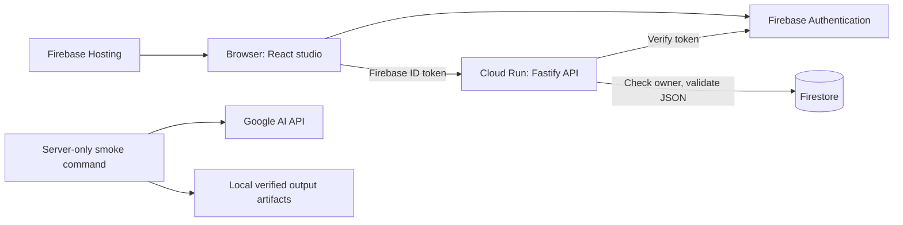
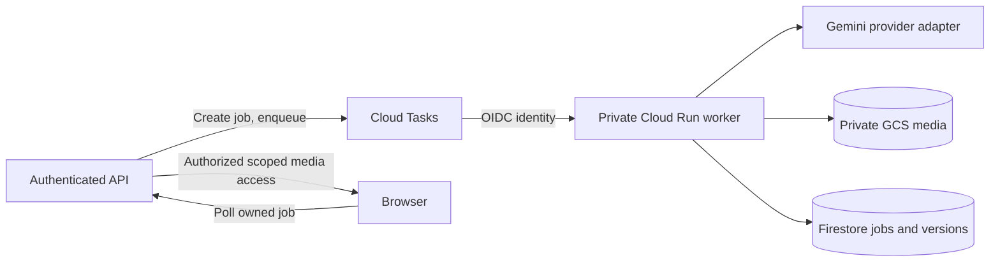

# Architecture

AniForge stores editable scene data separately from rendered video. A generated MP4 remains a flat clip. The P0 sequence is foundation/auth/projects, canvas and private assets, Gemini analysis, queued video, immutable conversational revisions, and deployment verification. `BUILD_PLAN.md` remains the product blueprint; `TODO.md` records implementation and test evidence.

## Foundation boundaries

| Workspace | Responsibility |
| --- | --- |
| `apps/web` | React/Vite/TypeScript studio, Firebase Auth, project gallery, editor shell, API requests with Firebase ID tokens |
| `apps/api` | Fastify API, Firebase Admin token verification, ownership checks, Firestore persistence, server-only Google AI smoke commands |
| `packages/shared` | Strict TypeScript/Zod API and editable scene contracts shared by browser and server |

The frontend never imports Firebase Admin or `@google/genai`. Public Firebase web configuration belongs in the Vite environment. Gemini credentials remain on the server. Local development may display an explicit setup state when credentials are absent; it must not manufacture successful sign-in, database writes, or AI output. Test fixtures are injected by tests and are not an alternative production provider.

Production API startup requires a Cloud project ID. Local health can boot without it, while project operations report that configuration is unavailable. Health proves the process is responding; it is not an assertion of database connectivity or model entitlement. The smoke commands are separate from public HTTP routes and explicitly opt into real billable calls.

## Data and trust boundaries

Project documents live at `projects/{projectId}` and contain `ownerId`; scenes are children at `projects/{projectId}/scenes/{sceneId}`. Every user route authenticates before accessing a project and checks ownership before reading or mutating its scenes. Cross-owner access is concealed with 404. Client-provided ownership and timestamps never authorize an operation. Zod schemas define accepted input and output.

All Firestore browser access is denied by `firestore.rules`. Admin SDK calls bypass rules, so IAM protects the database identity and the API enforces per-user isolation. This backend-only approach keeps the ownership policy in one application boundary. [Firestore security model](https://firebase.google.com/docs/firestore/security/overview).

Scene source uses canonical coordinates, object IDs, transforms, styles, layer ordering, and source asset references. Saving JSON preserves editability; a raster preview or generated clip cannot substitute for this source. API support for scene JSON is the persistence foundation, not evidence that the full brush/import/crop editor has been implemented.

## Later P0 services

This worker path is planned; Phase 1 does not expose generation, job, asset, or export endpoints. The intended state machine is `queued -> running -> succeeded|failed`. Task redelivery must be idempotent and preserve provider operation IDs. A model timeout, unsafe/malformed response, or denied entitlement must produce a visible failure and retain existing source and video versions.

Media belongs in a private bucket under `users/{uid}/projects/{projectId}/...`. Future upload completion validates stored metadata before registering an asset; reads issue short-lived signed access only after ownership checks or proxy through the API. Bucket IAM, public access prevention, and signing permissions are independent of Firebase Storage rules. No public media bucket is needed.

Each future video version records its parent version, scene/source snapshot, model, prompt, provider interaction ID when available, storage path, and creation state. Selecting an old version changes the scene selection; it never overwrites an MP4. Provider interaction metadata stays server-controlled. Follow-up editing must use a documented model operation and a real successful result before creating a successful new version.

## Build and verification

Node 24 and npm workspaces provide a single lockfile. Build shared contracts before API and web. Every milestone runs typecheck, lint, Vitest, and production build; Playwright covers the applicable browser smoke. CI has real AI disabled and no cloud credentials. Provider unit tests exercise explicit mocked responses; a real smoke run and deployment verification are separate evidence gates.

Firebase Hosting serves `apps/web/dist` with SPA routing. Cloud Run runs the unprivileged API container built from repository root. The runtime gets ADC from its service identity and the Gemini key from Secret Manager. See [the deployment runbook](cloud-setup.md) and [current API contract](api.md).
