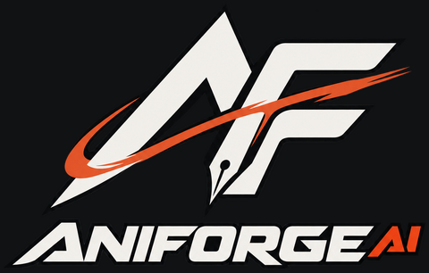
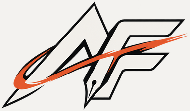

# AniForge AI logo assets

Integrated October 14, 2026. Desktop navigation and the homepage hero use the supplied wordmark; compact navigation uses the monogram. The homepage footer and README use the full stacked logo. Browser and touch icons use padded monogram exports. The social preview also includes the supplied wordmark. All home links retain their accessible names.

Typecheck, lint, 200 unit tests, 13 browser checks (35.6 seconds), production release build and bounded 29-file browser-artifact scan passed. Desktop/phone homepage and project dashboard screenshots were visually reviewed. [Desktop placement](homepage-desktop.png) and [phone placement](homepage-phone.png) show actual local rendering. Native crop pixels were compared with the source; those comparisons matched. Existing Zod annotation warnings and a non-blocking font-cache warning during social-card rendering were observed. No Firebase emulator rerun, paid AI call or deployment was performed for this brand update.

These assets are crops of the logo supplied by the project owner on October 14,
2026: `Aniforge AI Monogram Logo.png` (1254 × 1254, sRGB RGBA PNG). The original
file in Downloads was not changed. No design, lettering, colors or background
were generated or replaced.

Source SHA-256:

```text
c95821cdd3d885aeaa9a6e36bf18f2e33de9255a8bbdaeb4784b2653c2c4f71a
```

## Files and placement

Paths below are relative to `apps/web/public/brand/`; browser URLs start with
`/brand/`.

| File | Dimensions | Intended use |
| --- | --- | --- |
| `wordmark.webp` | 1118 × 150 | Header, navigation and hero wordmark |
| `monogram.webp` | 384 × 225 | Compact brand placements |
| `full-logo.webp` | 480 × 306 | Stacked brand placements and footer |
| `wordmark.png` | 1118 × 150 | Native-resolution cropped master / PNG fallback |
| `monogram.png` | 986 × 578 | Native-resolution cropped master / PNG fallback |
| `full-logo.png` | 1118 × 712 | Native-resolution cropped master / README |
| `favicon-32.png` | 32 × 32 | Browser favicon |
| `apple-touch-icon.png` | 180 × 180 | Touch icon |

Keep the natural aspect ratio; the monogram is wider than it is tall. Use an
accessible name on a logo link or button. Give the image empty alternative text
when that control already has its own accessible name. Otherwise use
`alt="AniForge AI"`.

## Crop and export details

Rectangles use zero-based source coordinates with width/height, not inclusive end
coordinates. The wordmark starts below the monogram at source row 852.

| Variant | Left | Top | Width | Height | Additional transparent padding |
| --- | ---: | ---: | ---: | ---: | --- |
| Monogram | 160 | 282 | 986 | 570 | 8 px bottom |
| Wordmark | 62 | 852 | 1118 | 142 | 8 px top |
| Full logo | 62 | 282 | 1118 | 712 | None |

Sharp performed the deterministic crops and exports. PNG masters preserve the
cropped pixels and alpha, with lossless compression level 9. The wordmark WebP
keeps the native dimensions for the large hero placement; monogram and full-logo
WebPs use proportional Lanczos3 downsampling. All WebPs use lossless encoding at
effort 6. The 32 px favicon contains the monogram within a 28 × 28 transparent square
plus 2 px padding. The 180 px touch icon uses a 156 × 156 transparent square plus
12 px padding.

The supplied image already has real transparency: 1,244,422 source pixels have
zero alpha. Very faint speckles with alpha below 8/255 extend outside the visible
artwork; cropping removes the distant empty margins without modifying alpha
within the crop. Visible artwork bounds at alpha ≥ 8/255 are x70–1171, y291–985.
The dark outlines are part of the supplied design and remain intact. There was
no black-background removal or color substitution.

## Visual review

The cropped assets were inspected on both dark and light backgrounds. These
flattened PNGs are review images only; production assets retain transparency.




